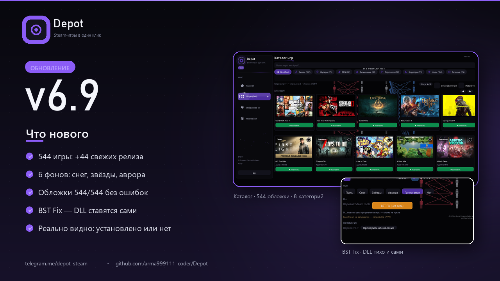

# Depot



Установщик Steam-инструмента на C++ для Windows: тихо ставит DLL-инструмент (BST Fix), качает pattern-файлы с GitHub и ставит игры (lua/manifest) через прокси. Две версии: **графическая** (Dear ImGui + DirectX 11) и **консольная**.

Текущая версия — **v6.9**. Telegram: [t.me/depot_steam](https://t.me/depot_steam)

## Возможности GUI (v6.9)

- **Анимированный сплэш** при запуске: радиальное свечение, вращающееся кольцо, частицы и прогресс-бар
- **Вкладка «Главная»** — лента новостей обновлений, hero-баннер со статистикой каталога
- **Вкладка «Игры»** — каталог из **544 игр** (+44 свежих релиза) с обложками из Steam CDN:
  - 8 категорий со своими иконками (Экшен, Шутеры, RPG, Выживание, Стратегии, Хорроры, Инди, Сетевые), поиск по названию/AppID
  - плавный зум обложки, пробегающий блик и неоновая рамка при наведении на карточку
  - установка в один клик, все операции — в фоне, окно не зависает
- **Вкладка «Избранное»** — сердечко на карточке и отдельный список избранных игр
- **Вкладка «Настройки»** — статусы DLL/PATTERN, кнопка **BST Fix (тихо)**, установка всего/игры/паттерна, удаление, ввод AppID, журнал
- **BST Fix** — DLL-инструмент ставится сам, незаметно: при первой установке игры (если комплекта DLL в Steam нет) качается скрипт с `steamtools.app` и релиз BetterSteamTools
- **Реальный статус установки** — «установлено» читается из манифестов Steam (`libraryfolders.vdf` + `appmanifest`, StateFlags), а не из журнала
- **Уведомления (toast)** и звук завершения установки
- **Проверка обновлений** прямо с GitHub (файл `VERSION`)
- Редизайн сайдбара: рисованные иконки, скользящая подсветка, акцентная пилюля
- Шрифты **Bahnschrift** и **Segoe UI Semibold** для заголовков
- **Свой цвет интерфейса** — палитра + 7 пресетов, сохраняется между запусками
- Тёмная тема, плавные анимации, режим **240 FPS**, **6 анимированных фонов** на выбор (пыль, снег, звёзды, аврора, гипергамия, нет)
- Переключение языка **RU/EN** на лету
- Рисованные элементы (иконки, сердечки, галочки) вместо ненадёжных глифов

## Консольная версия

Классическое меню в терминале: цвета, рамки, прогресс, подменю, те же действия (DLL, pattern, игры по AppID, удаление, RU/EN).

## Структура проекта

| Путь | Описание |
|------|----------|
| `src/gui_imgui.cpp` | GUI на Dear ImGui (окно, вкладки, каталог, темы, анимации) |
| `src/games.h` | Каталог игр: название, AppID, категория (544 шт.) |
| `src/core.h` / `src/core.cpp` | Путь Steam, DLL, pattern/IPC, скачивание и установка игр (общий для обеих версий) |
| `src/ui.h` / `src/ui.cpp` | Консольный UI (рамки, меню, прогресс) |
| `src/main.cpp` | Точка входа консольной версии |
| `src/common.h` | Общие типы, пути, язык |
| `legacy/gui_win32.cpp` | Старый Win32 GUI (заброшен, оставлен для истории) |
| `assets/payload.rc` | Пустой — DLL больше не вшиваются в exe, их ставит BST Fix |
| `build/hyper.rc` + `build/hypergamy.png` | Анимированный фон «гипергамия» (ресурс 777, `RCDATA`) |
| `assets/icon.rc` + `assets/icon.ico` | Иконка обоих exe (генерируется скриптом, коммитится готовый `.ico`) |
| `assets/res/` | Папка с DLL от старых сборок (в репозиторий не входит) |
| `build/depot.exe` | Собранная GUI-версия |
| `third_party/imgui/` | Исходники Dear ImGui (клонируются отдельно, в репозиторий не входят) |

## Используемые DLL

DLL-инструмент ставится в папку Steam **тихо, без окон**, через официальный setup-скрипт:

1. GUI при первой установке игры (если комплекта DLL в Steam ещё нет) качает `bst-fix.ps1` с `steamtools.app`
2. по ссылке из скрипта качает релиз [BetterSteamTools v1.0.4](https://github.com/madoiscool/BetterSteamTools) и распаковывает его прямо в папку Steam: `dwmapi.dll`, `OpenSteamTool.dll`, `xinput1_4.dll` (+ отладочные `*.exp`/`*.lib`)
3. Steam на время закрывается и запускается обратно, если был открыт

Кнопка **BST Fix (тихо)** в настройках делает то же самое по требованию. Steam-игры через этот набор DLL запускаются без «зелёной кнопки».

**Эти DLL не мои.** Это проект [BetterSteamTools](https://github.com/madoiscool/BetterSteamTools) (форк OpenSteamTool), ставится как есть. Бинарники не входят в репозиторий. Внимание: антивирус может ругаться/удалять эти файлы — добавьте папку Steam и папку проекта в исключения Defender.

## Внешние источники

- **Pattern (steamui + steamclient, ветка `pattern`):** `https://codeload.github.com/OpenSteam001/steam-monitor/zip/refs/heads/pattern`
- **IPC-спеки (ветка `ipc`):** `https://codeload.github.com/OpenSteam001/steam-monitor/zip/refs/heads/ipc`
- **Lua/manifest игр:** `https://walftech.com/proxy.php?url=https://steamgames554.s3.us-east-1.amazonaws.com/{appid}.zip` (провайдер под DPI-блоком, обычно нужен VPN)
- **Обложки каталога:** `https://cdn.cloudflare.steamstatic.com/steam/apps/{appid}/capsule_616x353.jpg` (кеш в `%TEMP%/ost_covers`)
- **GUI:** [Dear ImGui](https://github.com/ocornut/imgui) (Win32 + DirectX 11)

## Сборка

Зависимости: Windows 10/11 x64, MinGW-w64 (g++ C++17, `-static`).

```bat
:: 0. Для GUI: склонировать ImGui в third_party
git clone --depth 1 https://github.com/ocornut/imgui.git third_party/imgui

:: 1. GUI-версия
windres -O coff -i assets/icon.rc -o build/icon.res
windres -O coff -i build/hyper.rc -o build/hyper.res
g++.exe -O2 -std=c++17 -mwindows -static -fexec-charset=UTF-8 ^
  -Isrc -Ithird_party/imgui -Ithird_party/imgui/backends -o build/depot.exe ^
  src/gui_imgui.cpp src/core.cpp src/ui.cpp build/icon.res build/hyper.res ^
  third_party/imgui/imgui.cpp third_party/imgui/imgui_draw.cpp third_party/imgui/imgui_tables.cpp ^
  third_party/imgui/imgui_widgets.cpp third_party/imgui/imgui_demo.cpp ^
  third_party/imgui/backends/imgui_impl_win32.cpp third_party/imgui/backends/imgui_impl_dx11.cpp ^
  -ld3d11 -ldxgi -ld3dcompiler -ldwmapi -lgdiplus -lwininet -lshell32 -lgdi32 -luser32 -lwinmm -lole32

:: 2. Консольная версия
windres -O coff -i assets/icon.rc -o build/icon.res
g++.exe -O2 -std=c++17 -static -mconsole -fexec-charset=UTF-8 ^
  -Isrc -o build/installer.exe src/main.cpp src/ui.cpp src/core.cpp build/icon.res ^
  -lwininet -lshell32 -lgdi32 -luser32 -lole32
```

Без флага `-municode`: используются `PROCESSENTRY32A` / ANSI-версии WinAPI.

## Как это работает

1. **Путь Steam** — из реестра (`HKLM\SOFTWARE\WOW6432Node\Valve\Steam` и др.)
2. **DLL** — тихо ставятся через BST Fix (скрипт с `steamtools.app` → релиз BetterSteamTools → распаковка в папку Steam; Steam на время закрывается и возвращается)
3. **Pattern** — zip с GitHub распаковывается, `steamui` и `steamclient` копируются в `opensteamtool\pattern`
4. **Игры** — zip качается через walftech-прокси, `*.lua` → `config\Lua` и `config\stplug-in`, `*.manifest` → `depotcache`
5. **Обложки** — качаются в 6 потоков тихим WinINet-клиентом (без окон консоли), кеш в `%TEMP%`
6. **Статус «установлено»** — читается из Steam: `libraryfolders.vdf` + `appmanifest_*.acf` (StateFlags, бит 4) с проверкой непустой папки игры

## Правовая информация

Проект в образовательных целях, используйте на свой страх и риск. AppID игр сверены со SteamDB на момент релиза; если установка конкретной игры падает — проверьте ID на [steamdb.info](https://steamdb.info).
